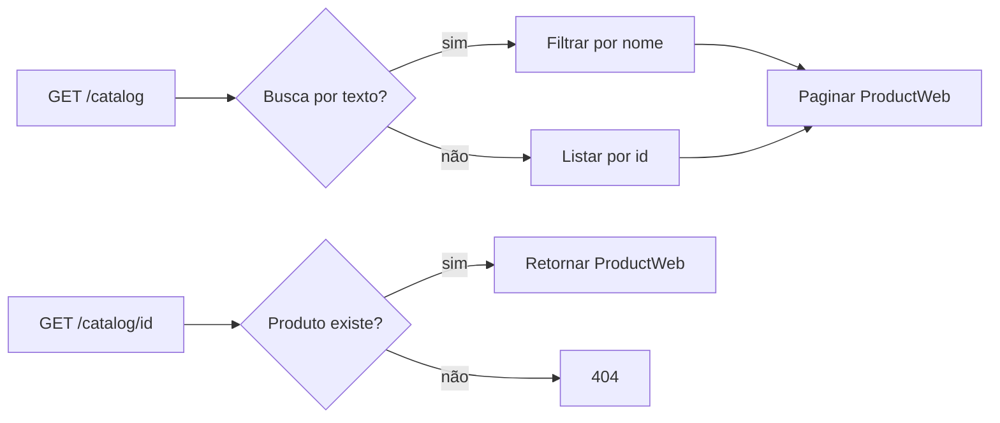

# BP-002 — Consultar catálogo

**Situação:** Implementado

**Objetivo:** permitir consulta pública da oferta cadastrada.

**Gatilho:** `GET /catalog` ou `GET /catalog/{id}`.

**Fluxo:** recebe paginação e busca opcional; sem texto, lista produtos por id ascendente; com texto, filtra por nome; por id, exige produto existente. A rota é pública (`CatalogController.java:14-28`, `ProductService.java:42-59`, `SecurityConfig.java:33`).

**Regras:** a pesquisa é case-insensitive; a paginação é preservada; produto inexistente gera erro de entidade não encontrada. O processo não valida `inventoryStatus` e não impede a visualização de produtos marcados como `OUTOFSTOCK`.

**Resultado:** representação `ProductWeb`; nenhuma mudança de estado.

**Evidência:** `CatalogController.java`, `ProductService.java` e `SecurityConfig.java`.
