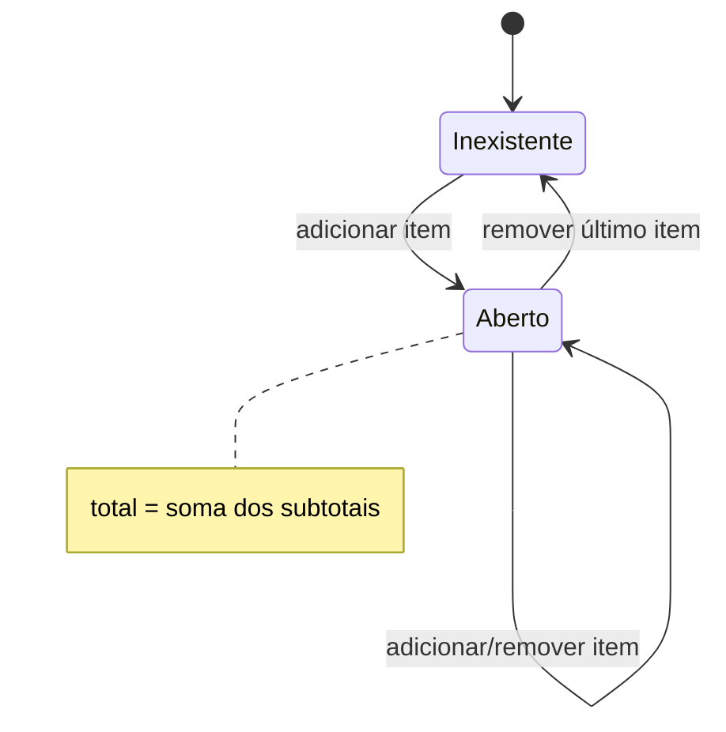

# BP-005 — Montar e manter carrinho

**Situação:** Implementado

**Objetivo:** manter uma cesta por usuário, seus itens e o total calculado.

**Adicionar item:** recebe produto e quantidade, carrega o produto, calcula `preço × quantidade` com escala 2 e `HALF_UP`, cria ou reutiliza o carrinho único do usuário, soma o total e grava `CartItem` com preço congelado no momento da inclusão (`CreateShoppingCartItemService.java:30-37`, `60-70`). A unicidade de carrinho por usuário é reforçada pelo índice `idx_cart_user_id` (`V3__create_cart.sql`).

**Adicionar se ausente:** verifica se já existe item do mesmo produto para aquele usuário; se existir, retorna `created=false` sem alterar quantidade; caso contrário, executa a inclusão (`CreateShoppingCartItemService.java:40-46`).

**Alterar quantidade:** recarrega o item, recalcula seu total usando o preço armazenado, substitui no total do carrinho e salva (`UpdateShoppingCartItemService.java:21-34`).

**Remover item:** exclui o item; se restarem itens, subtrai seu total do carrinho; se não restar nenhum, exclui o carrinho (`RemoveShoppingCartItemService.java:18-29`).

**Consultar:** lista itens do usuário e conta itens; consultas administrativas também existem em `/cart-items`, `/carts` e `/shopping-cart`.

**Regras explícitas:** um carrinho por usuário; total é soma dos subtotais; subtotal é preço do item multiplicado pela quantidade; inclusão condicional não duplica produto. Não foram encontradas validações de quantidade positiva, estoque disponível, preço vigente, proprietário do item na atualização/remoção ou congelamento transacional do catálogo.

**Ciclo de vida:** `inexistente → aberto/com itens → aberto/com itens alterados → inexistente` quando o último item é removido. Não há estado `checked-out`, `paid`, `cancelled` ou `expired` para `Cart`.

**Evidência:** serviços de shopping cart e `V3__create_cart.sql`.
