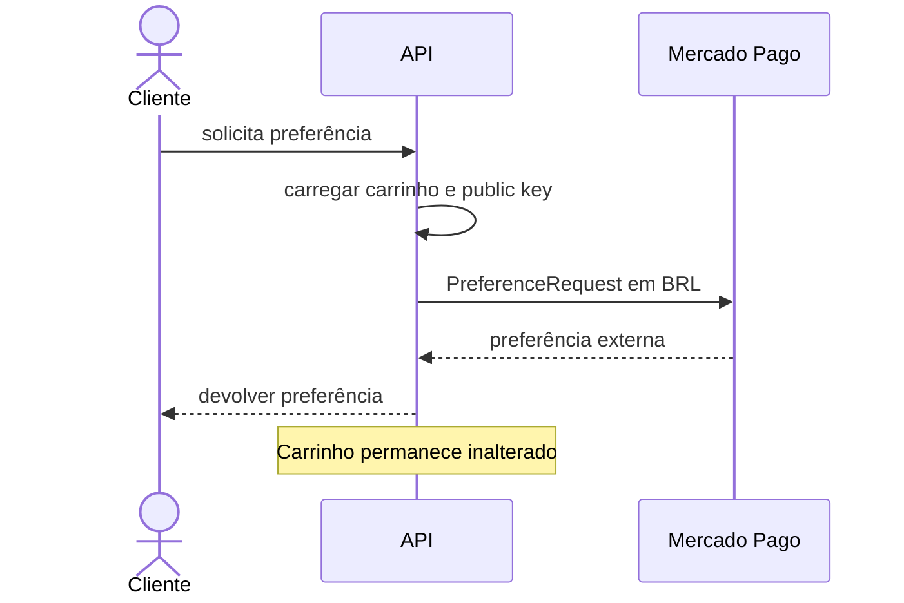

# BP-006 — Criar preferência de pagamento

**Situação:** Implementado

**Objetivo:** transformar o carrinho atual em uma sessão de checkout do Mercado Pago.

**Pré-condições:** usuário autenticado, carrinho existente, chave pública do usuário preenchida e itens localizados. A ausência do carrinho ou da chave interrompe o processo (`CreatePreferenceService.java:51-54`).

**Fluxo:** carrega carrinho por username; converte cada item para título, descrição, imagem, categoria, quantidade, moeda BRL e preço unitário; cria `PreferenceRequest` com `externalReference = cart.id`, taxa de marketplace de `0.03`, retorno automático e a mesma URL para sucesso, falha e pendência; envia à API Mercado Pago com chave de idempotência aleatória (`CreatePreferenceService.java:51-83`).

**Integrações:** SDK `PreferenceClient` do Mercado Pago. Exceções da API são registradas e convertidas em `RuntimeException` (`CreatePreferenceService.java:55-60`).

**Resultado:** preferência externa devolvida ao cliente. O carrinho não muda de estado, não é esvaziado e não é marcado como pago.

**Evidência:** `CreatePreferenceService.java` e `CartPreferenceConverter.java`.
