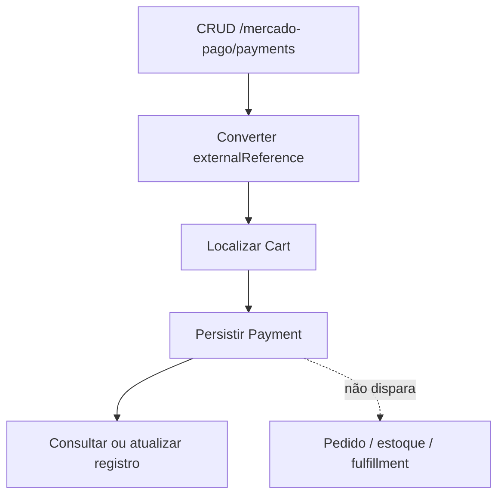

# BP-007 — Registrar pagamento recebido

**Situação:** Implementado como persistência

**Objetivo:** guardar dados de pagamento associados a um carrinho.

**Gatilho atual:** chamada autenticada ao CRUD `/mercado-pago/payments`; não há evidência de que o webhook invoque este serviço.

**Fluxo:** ao criar, converte `externalReference` para inteiro, localiza o carrinho pelo id e salva `Payment`; atualização copia os campos para o pagamento existente; consulta permite filtrar por texto no status (`PaymentService.java:17-45`). A tabela guarda ids do pagamento, status, referência externa, merchant order e detalhe JSON (`Payment.java:20-62`, `V5__create_payment.sql`).

**Estados:** `status` é texto livre. Não há enum, máquina de estados, validação de transição, idempotência por `paymentId` ou regra que vincule status a um avanço do carrinho.

**Resultado:** registro persistido. O processo não confirma pedido, não baixa estoque, não dispara evento e não liquida/reembolsa.

**Evidência:** `PaymentService.java`, `Payment.java` e `V5__create_payment.sql`.
