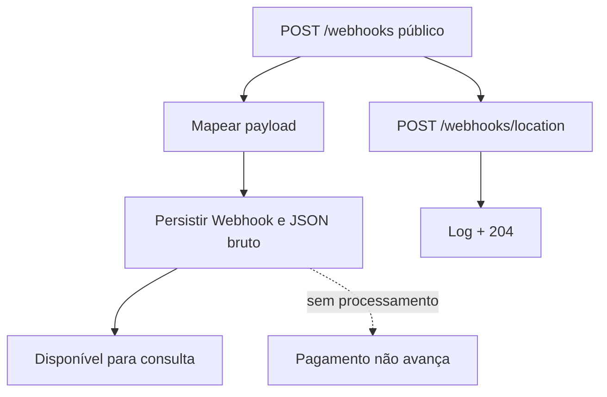

# BP-008 — Registrar webhook

**Situação:** Implementado como persistência

**Objetivo:** aceitar e armazenar notificações externas para auditoria ou processamento posterior.

**Fluxo:** POST `/webhooks` é público, mapeia o payload para `Webhook` e salva action, versão, data, id externo, modo live, tipo, usuário e JSON bruto (`WebhookController.java:21-24`, `Webhook.java:20-72`). POST `/webhooks/location` apenas registra no log e responde 204 (`WebhookController.java:27-30`).

**Conclusão:** existe recepção/persistência de webhook, mas não processamento de negócio. Não há consumidor que atualize `Payment`, `Cart` ou `Product` após o webhook.

**Evidência:** `WebhookController.java`, `Webhook.java` e `SecurityConfig.java`.
