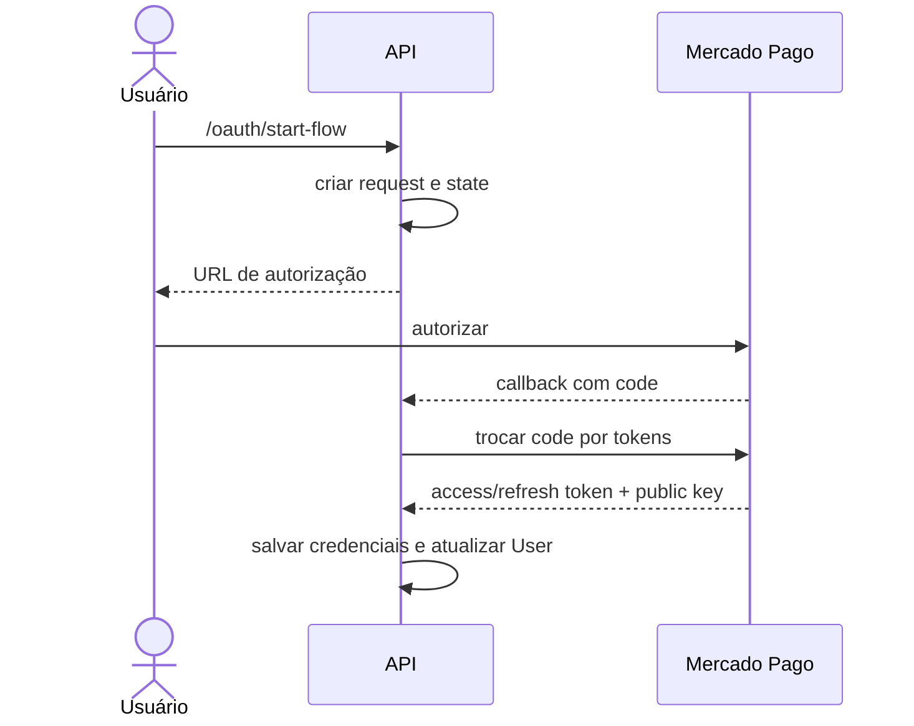

# BP-009 — Autorizar Mercado Pago para o usuário

**Situação:** Implementado com lacunas de segurança e validade

**Objetivo:** obter credenciais Mercado Pago e public key para o checkout.

**Fluxo principal:** usuário autenticado chama `/oauth/start-flow`; o sistema localiza o usuário por external id, grava request com client id, redirect URI e state UUID, guarda o state em campo da instância do controller e devolve URL de autorização. No callback com `code`, recupera o request pelo state, grava authorization code, chama Mercado Pago com `authorization_code`, salva access/refresh token, public key e escopo e copia a public key para `User`; depois redireciona ao frontend (`OAuthController.java:38-58`, `OAuthService.java:40-95`).

**Estados persistidos:** request OAuth; authorization code com `used=false`; token com `expiresAt` preenchido com o instante atual. Não há consumo/invalidação do code, checagem de expiração, refresh, revogação ou uso de `expiresIn` no cálculo de validade (`OAuthService.java:57-86`).

**Risco/lacuna:** o state é mantido em atributo singleton do controller, não por sessão/usuário, e o callback recebe somente `code`; a correlação concorrente e a validação de state/redirect URI devem ser revisadas antes de considerar o processo robusto.

**Evidência:** `OAuthController.java` e `OAuthService.java`.
