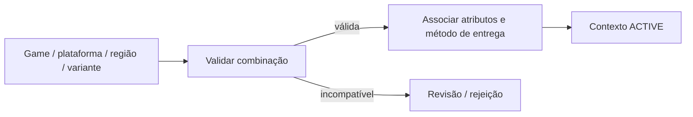

# BP-010 — Configurar contexto de game, plataforma, região e variante

**Classificação:** [PARCIALMENTE IMPLEMENTADO — ESSENCIAL]

**Objetivo:** determinar o contexto no qual um item ou serviço pode ser vendido e entregue.

**Atores:** administrador de catálogo, operador e cliente; game/publisher como restrição externa.

**Trigger:** onboarding ou alteração de game, plataforma, região, servidor, categoria, tipo de produto ou variante.

**Fluxo e resultado:** cadastrar o contexto válido; associar atributos obrigatórios e restrições; publicar somente combinações válidas. O resultado é um `GameContext` versionado que poderá ser referenciado por uma `Offer`; preço, disponibilidade e método de entrega pertencem ao processo de oferta.

**Estados/eventos:** `ACTIVE`, `INACTIVE` e `DISCONTINUED`; `GameContextConfigured`, `GameContextInactivated` e `GameContextDiscontinued`.

**Exception paths:** combinação incompatível, contexto descontinuado, regra do publisher não confirmada.

**Evidência:** **[EVIDÊNCIA INTERNA]** `GameContext` agora possui entidade, consulta pública, status e histórico; a associação com `Offer` ainda pertence ao BP-011/PLAN-002. **[EVIDÊNCIA EXTERNA]** páginas públicas da MMOExp organizam catálogo por games, produtos, plataformas e tipos de serviço ([home](https://www.mmoexp.com/), [delivery times](https://www.mmoexp.com/About/how-long-will-it-take-to-receive-my-order-after-payment.html)). **[A VALIDAR]** quais games, plataformas e campos serão suportados.

**PRD relacionado:** [PRD-001](../../prd/PRD-001-contexto-game-variante.md).
