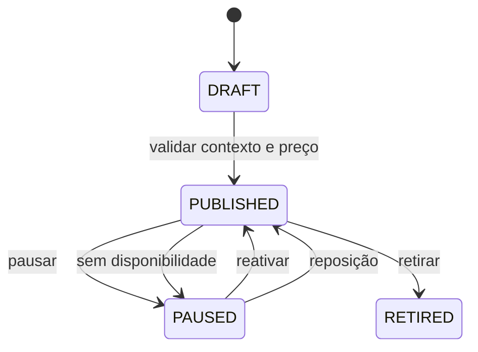

# BP-011 — Publicar e administrar disponibilidade da oferta

**Classificação:** [PARCIALMENTE MODELADO]

**Objetivo:** transformar um produto catalogado em uma oferta vendável, com preço, quantidade, contexto, disponibilidade e método de entrega vigentes.

**Atores:** administrador, operador, fornecedor/seller se aplicável.

**Trigger:** criação, alteração, indisponibilidade ou reposição de supply.

**Fluxo e resultado:** validar produto e `GameContext` ativo; determinar preço, disponibilidade e método de entrega; publicar, pausar, reativar ou retirar a oferta. A oferta não deve ser confundida com o `Product` catalogado.

**Estados/eventos:** `DRAFT → PUBLISHED → PAUSED → PUBLISHED/RETIRED`; disponibilidade sem estoque é uma condição que impede publicação/checkout, não um estado adicional da oferta. Eventos: `OfferPublished`, `OfferPaused`, `OfferRetired`, `AvailabilityChanged`.

**Evidência:** **[EVIDÊNCIA INTERNA]** BP-003 publica produto e armazena `inventoryStatus`, mas ainda não possui `Offer`; o `GameContext` foi modelado separadamente e a publicação de oferta continua pendente do PLAN-002. **[INFERIDO]** o domínio precisa separar “o que existe no catálogo” de “o que pode ser comprado agora”.

**PRD relacionado:** [PRD-002](../../prd/PRD-002-oferta-disponibilidade.md).
