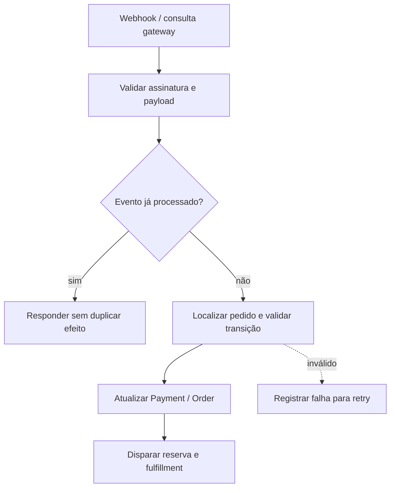

# BP-015 — Confirmar pagamento e processar webhook idempotentemente

**Classificação:** [PARCIALMENTE MODELADO]

**Objetivo:** transformar uma notificação/consulta confiável do gateway em decisão de pagamento aplicável ao pedido.

**Atores:** Mercado Pago, plataforma e operador de pagamentos.

**Trigger:** webhook, consulta de status, retry ou reconciliação.

**Fluxo:** autenticar/validar notificação; localizar pedido por referência segura; deduplicar evento; validar transição; atualizar payment/order; disparar reserva/fulfillment; registrar falhas para retry.

**Exception paths:** webhook duplicado, fora de ordem, inválido, assinatura ausente, payment inexistente ou status incompatível.

**Evidência:** **[EVIDÊNCIA INTERNA]** BP-008 apenas persiste JSON e BP-007 persiste `Payment`; não há confirmação, idempotência ou avanço do pedido. **[A VALIDAR]** contrato de assinatura e eventos efetivamente disponíveis no Mercado Pago.

**PRD relacionado:** [PRD-006](../../prd/PRD-006-confirmacao-pagamento.md).
