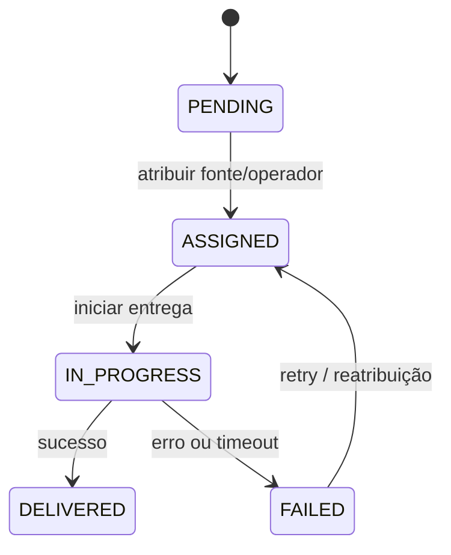

# BP-016 — Criar e executar fulfillment

**Classificação:** [FALTANTE — ESSENCIAL]

**Objetivo:** converter um pedido pago e alocado em uma entrega executável.

**Atores:** plataforma, operador, supplier/seller e cliente.

**Trigger:** pagamento aprovado, risco liberado e supply alocado.

**Fluxo:** criar fulfillment; atribuir fonte/operador; preparar entrega conforme game e produto; iniciar tentativa; registrar progresso; concluir ou encaminhar exceção.

**Estados/eventos:** `PENDING → ASSIGNED → IN_PROGRESS → DELIVERED/FAILED`; `FulfillmentCreated`, `FulfillmentStarted`, `FulfillmentCompleted`.

**Evidência:** **[EVIDÊNCIA INTERNA]** não há fulfillment, assignment, fila ou entrega. **[EVIDÊNCIA EXTERNA]** a referência pública descreve order, pay, allocation e delivery como etapas distintas ([produto Steam](https://www.mmoexp.com/Account/Steam/169425005.html)).

**PRD relacionado:** [PRD-007](../../prd/PRD-007-fulfillment.md).
