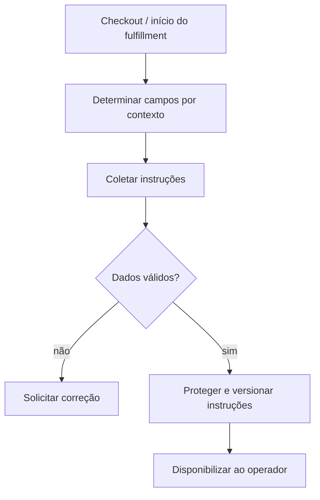

# BP-017 — Coletar e validar instruções de entrega

**Classificação:** [FALTANTE — ESSENCIAL]

**Objetivo:** obter os dados necessários para executar a entrega sem tratar campos específicos de um game como universais.

**Atores:** cliente, plataforma e operador.

**Trigger:** checkout ou início de fulfillment.

**Fluxo:** determinar campos por game × produto × plataforma × servidor × método; coletar e validar; solicitar correção; proteger acesso operacional e registrar versão usada na entrega.

**Evidência:** **[EVIDÊNCIA INTERNA]** não existem dados de character, nickname, server, region, platform ou instruções. **[EVIDÊNCIA EXTERNA]** a MMOExp informa delivery por mail/face-to-face e tempos dependentes de produto e contexto ([FAQ](https://www.mmoexp.com/About/regular-questions-about-using.html), [delivery times](https://www.mmoexp.com/About/how-long-will-it-take-to-receive-my-order-after-payment.html)). **[A VALIDAR — GAME/PUBLISHER TERMS]** campos e métodos permitidos.

**PRD relacionado:** [PRD-008](../../prd/PRD-008-entrega-evidencia.md).
