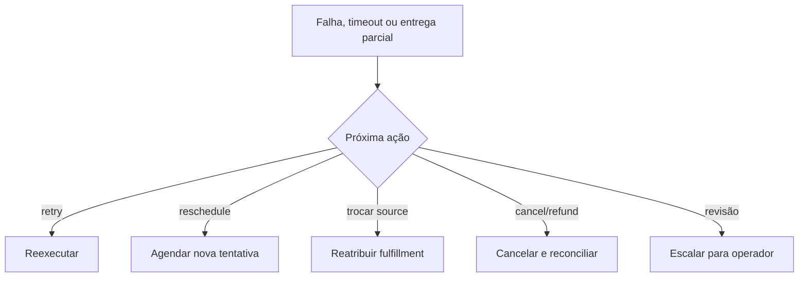

# BP-019 — Tratar falha, timeout e fulfillment parcial

**Classificação:** [FALTANTE — IMPORTANTE]; **[A VALIDAR]** se quantidades parciais serão permitidas.

**Objetivo:** decidir o próximo passo quando a entrega não ocorre, demora ou ocorre apenas parcialmente.

**Atores:** operador, cliente, supplier/seller, suporte e plataforma.

**Trigger:** erro de entrega, timeout, falta de estoque, manutenção do game, informação incorreta ou entrega parcial.

**Decisões:** retry, reschedule, pedir ação do cliente, trocar source/método, completar saldo remanescente, cancelar, refund ou revisão manual.

**Evidência:** **[EVIDÊNCIA EXTERNA]** a política pública da MMOExp trata atraso por informação incorreta, falta de stock e refund; seus tempos também variam por produto ([refund policy](https://www.mmoexp.com/Refund.html), [delivery times](https://www.mmoexp.com/About/how-long-will-it-take-to-receive-my-order-after-payment.html)). Não se importam os prazos ou políticas da referência.

**PRD relacionado:** [PRD-009](../../prd/PRD-009-excecoes-cancelamento.md).
