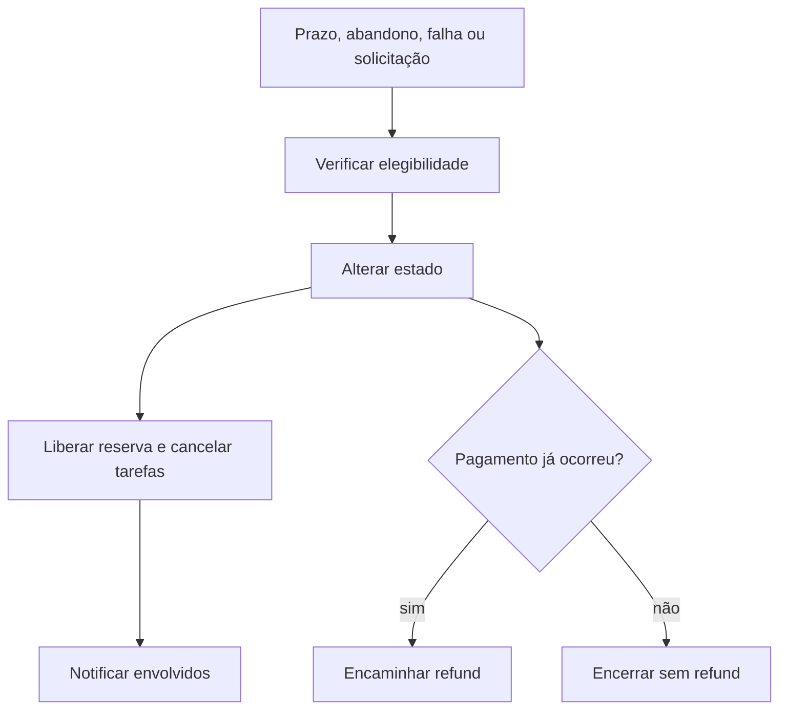

# BP-020 — Expirar e cancelar carrinho, pedido ou reserva

**Classificação:** [FALTANTE — IMPORTANTE]

**Objetivo:** encerrar com segurança fluxos que não prosseguem e liberar recursos.

**Atores:** cliente, plataforma e operador automático.

**Trigger:** prazo, abandono, falha de pagamento, solicitação do cliente, falta de supply ou timeout de fulfillment.

**Fluxo:** detectar condição; decidir elegibilidade; alterar estado; liberar reserva; cancelar tarefas; notificar; encaminhar refund quando o pagamento já ocorreu.

**Evidência:** **[EVIDÊNCIA INTERNA]** não há estados de expiração/cancelamento nem scheduler, job ou release de inventory.

**PRD relacionado:** [PRD-009](../../prd/PRD-009-excecoes-cancelamento.md).
