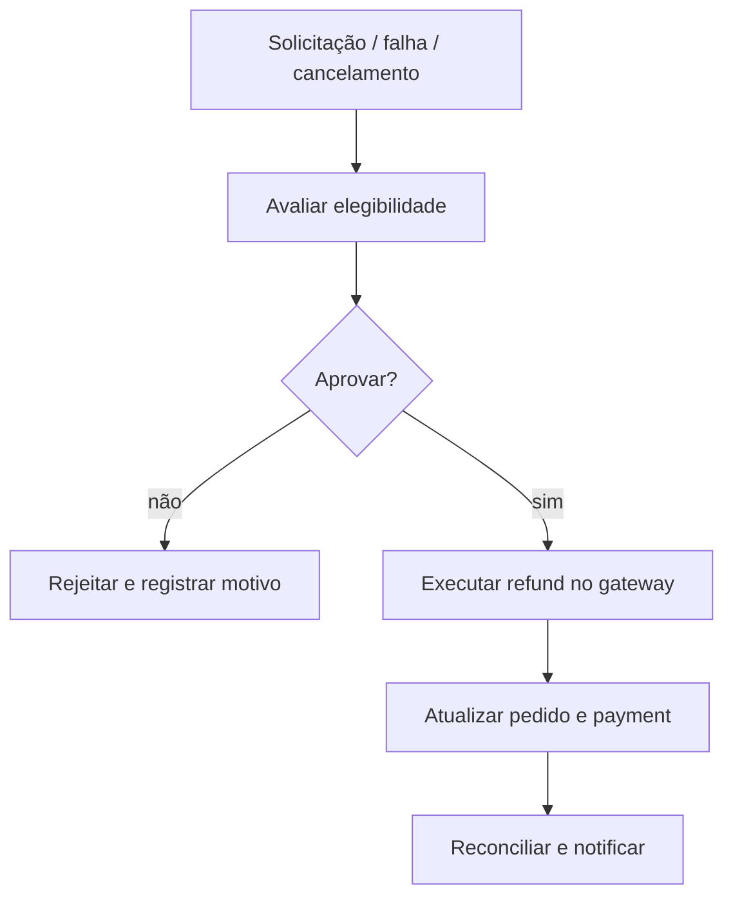

# BP-021 — Solicitar, decidir e executar refund

**Classificação:** [FALTANTE — IMPORTANTE]

**Objetivo:** tratar devolução integral ou parcial após cancelamento, falha, disputa ou inelegibilidade.

**Atores:** cliente, suporte, operador financeiro, payment provider e plataforma.

**Trigger:** solicitação, falha de entrega, cancelamento, decisão de disputa ou chargeback.

**Fluxo:** receber solicitação; avaliar elegibilidade; aprovar/rejeitar; executar refund no gateway; atualizar pedido/payment; reconciliar; notificar.

**Evidência:** **[EVIDÊNCIA INTERNA]** não há refund. **[EVIDÊNCIA EXTERNA]** a política da MMOExp distingue refund antes da conclusão, falha em prazo, pedido concluído e correção de dados ([Refund Policy](https://www.mmoexp.com/Refund.html)). Prazos e critérios locais permanecem **[A VALIDAR]**.

**PRD relacionado:** [PRD-010](../../prd/PRD-010-pos-venda-financeiro.md).
