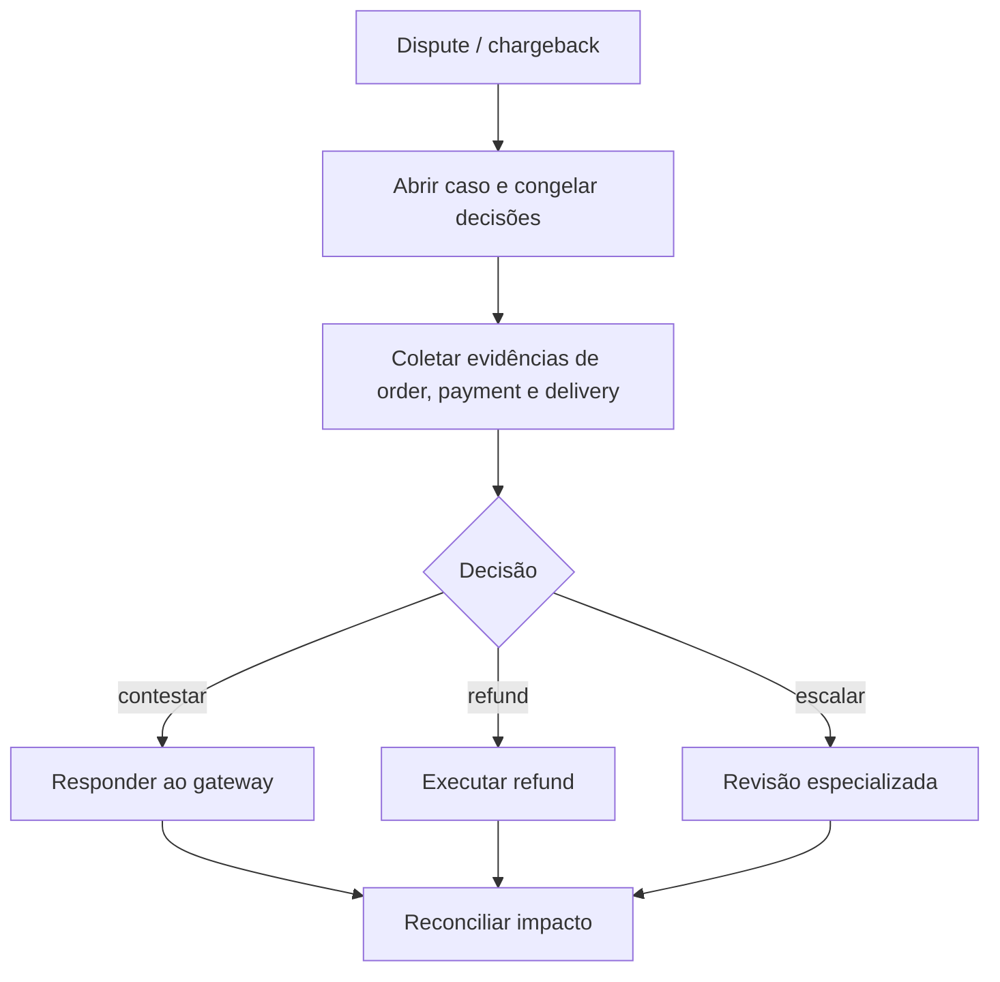

# BP-022 — Tratar disputa e chargeback

**Classificação:** [FALTANTE — IMPORTANTE]

**Objetivo:** investigar reclamações e reversões iniciadas pelo cliente ou pelo provedor financeiro, preservando evidência e impacto financeiro.

**Atores:** cliente, suporte, risco, financeiro, payment provider e supplier/seller.

**Trigger:** dispute, chargeback, contestação de entrega ou alerta do gateway.

**Fluxo:** abrir caso; congelar decisões conflitantes; coletar order/payment/delivery evidence; decidir reject/retry/partial refund/full refund/escalation; responder ao gateway; reconciliar impacto e risco do cliente/source.

**Evidência:** **[EVIDÊNCIA INTERNA]** não há dispute, chargeback, evidência ou case management. **[A VALIDAR]** prazos, direitos, responsabilidade e política de risco.

**PRD relacionado:** [PRD-010](../../prd/PRD-010-pos-venda-financeiro.md).
