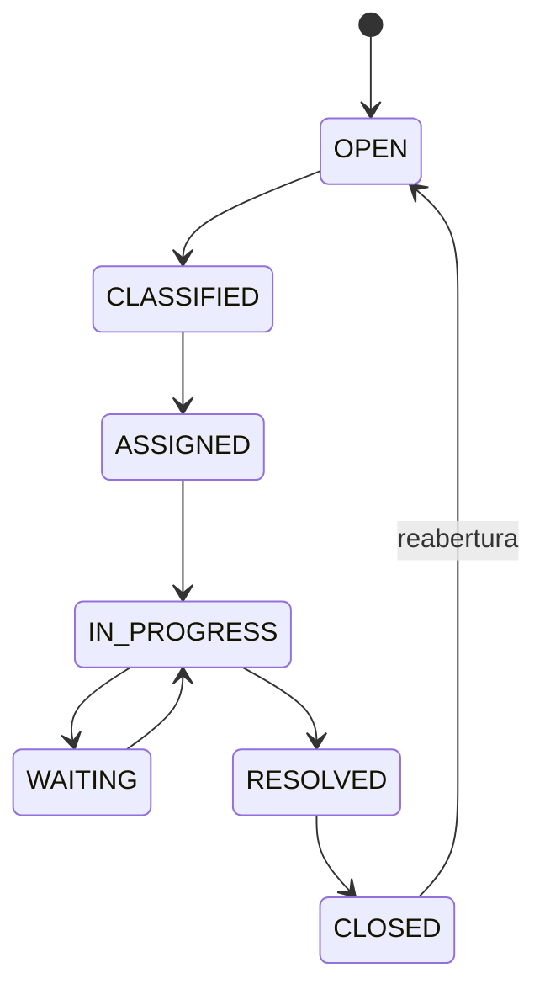

# BP-023 — Operar suporte pré-venda, venda e pós-venda

**Classificação:** [FALTANTE — IMPORTANTE]

**Objetivo:** receber, classificar, atribuir, resolver e encerrar problemas de cliente ou operação.

**Atores:** cliente, agente de suporte, operador, financeiro e risco.

**Trigger:** pergunta, pedido em atraso, payment issue, delivery failure, refund, dispute ou account issue.

**Estados:** `OPEN → CLASSIFIED → ASSIGNED → WAITING/IN_PROGRESS → RESOLVED → CLOSED`, com reabertura quando necessário.

**Evidência:** **[EVIDÊNCIA INTERNA]** não há ticket, fila ou SLA documentado. **[EVIDÊNCIA EXTERNA]** a MMOExp expõe suporte pré, durante e pós-venda e atendimento contínuo ([Contact](https://www.mmoexp.com/Contact.html), [Help Center](https://www.mmoexp.com/About/help.html)). Canais e SLA locais são **[A VALIDAR]**.

**PRD relacionado:** [PRD-011](../../prd/PRD-011-suporte.md).
