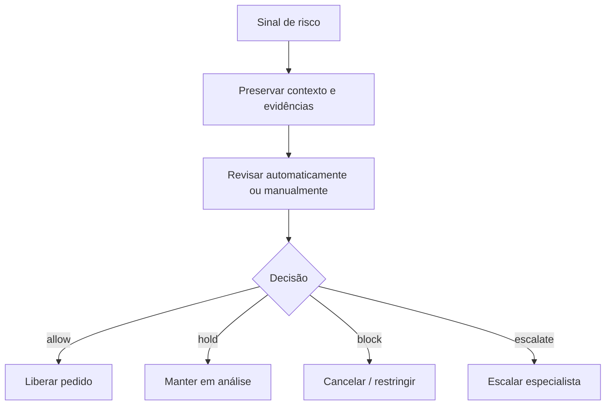

# BP-026 — Avaliar risco e executar revisão manual

**Classificação:** [FALTANTE — IMPORTANTE]; políticas **[A VALIDAR]**

**Objetivo:** decidir se uma transação pode prosseguir, aguardar verificação ou deve ser bloqueada/revertida.

**Atores:** risk operator, payment provider, suporte e plataforma.

**Trigger:** pedido de alto risco, padrão suspeito, inconsistência de conta, abuso de cupom/refund ou chargeback.

**Fluxo:** sinalizar; preservar contexto; revisar; decidir allow/hold/block; registrar motivo e evidências; liberar, cancelar ou escalar.

**Evidência:** **[EVIDÊNCIA INTERNA]** não há revisão manual ou política antifraude. **[EVIDÊNCIA EXTERNA]** a referência descreve payment risk control e verificação adicional para alguns pedidos ([produto Steam](https://www.mmoexp.com/Account/Steam/169425005.html), [FAQ](https://www.mmoexp.com/About/regular-questions-about-using.html)). Não se inferem thresholds ou regras específicas.

**PRD relacionado:** [PRD-014](../../prd/PRD-014-risco.md).
