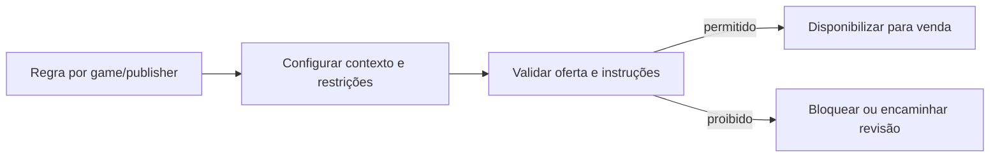

# BP-027 — Administrar regras por game/publisher e restrições

**Classificação:** [FALTANTE — IMPORTANTE]; **[A VALIDAR — GAME/PUBLISHER TERMS]**

**Objetivo:** manter as regras operacionais que tornam uma oferta tecnicamente e comercialmente permitida.

**Atores:** administrador, compliance, operador e publisher como fonte externa.

**Abrangência:** métodos de entrega, campos de account, quantidade, regiões, servidores, períodos de manutenção, restrições de conta e uso de dados. Regras devem ser configuráveis por contexto, não embutidas como universalidade.

**Evidência:** **[EVIDÊNCIA INTERNA]** não há configuração por game e o catálogo possui atributos genéricos. **[EVIDÊNCIA EXTERNA]** a MMOExp informa variação de método, produto e tempo por game ([FAQ](https://www.mmoexp.com/About/regular-questions-about-using.html)). Possibilidade técnica não equivale a permissão operacional.

**PRD relacionado:** [PRD-015](../../prd/PRD-015-regras-game-publisher.md).
