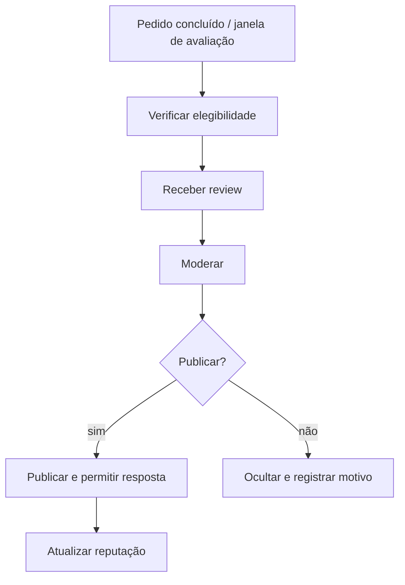

# BP-029 — Coletar reviews e administrar reputação

**Classificação:** [FALTANTE — EVOLUTIVO]; **[A VALIDAR]**

**Objetivo:** obter feedback de transações elegíveis, moderar e usar sinais de qualidade.

**Atores:** cliente, plataforma, moderador e operador.

**Trigger:** pedido concluído, janela de avaliação ou denúncia.

**Fluxo:** determinar elegibilidade; receber; moderar; publicar/ocultar; responder; associar ao produto/serviço sem permitir abuso.

**Evidência:** **[EVIDÊNCIA INTERNA]** `Product.rating` existe como campo, mas não há processo de review. **[EVIDÊNCIA EXTERNA]** a MMOExp publica reviews verificadas e respostas da equipe ([Reviews](https://www.mmoexp.com/reviews.html)). O campo isolado não prova que esse processo seja requisito imediato.

**PRD relacionado:** [PRD-016](../../prd/PRD-016-reviews-reputacao.md).
