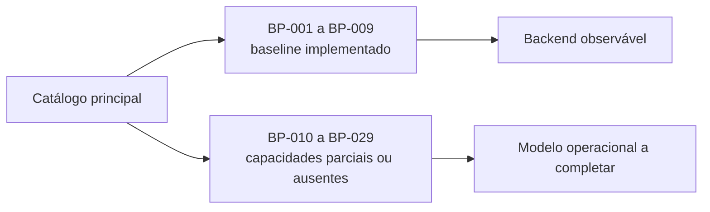

# Catálogo de processos

Este diretório contém um documento por processo do catálogo. O arquivo [`business-processes.md`](business-processes.md) permanece como visão consolidada, matriz de rastreabilidade e fonte da análise do estado atual.

Cada documento registra objetivo, atores, gatilho, fluxo, estados, exceções, evidências e decisões pendentes. “Implementado” descreve comportamento observado no backend; “ausente” descreve uma capacidade esperada, não uma implementação existente.

| Faixa | Conteúdo |
|---|---|
| BP-001 a BP-009 | Baseline implementado e integrações atuais |
| BP-010 a BP-029 | Capacidades parciais ou ausentes necessárias ao modelo operacional |

Use o [catálogo principal](business-processes.md#7-catálogo-de-processos) para navegar pela situação de cada processo.
